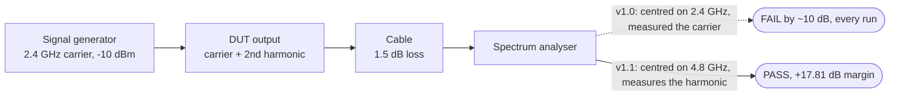
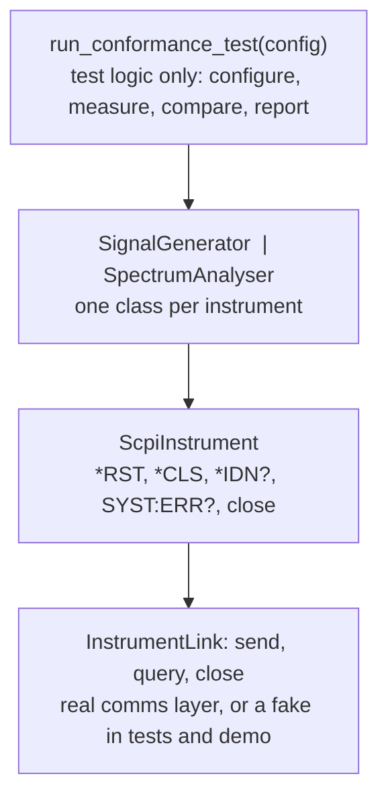

<div align="center">

# RF Conformance Test Automation

**Python drives a signal generator and a spectrum analyser over SCPI, measures an RF emission, checks it against a spec limit and reports PASS / FAIL with a compliance margin.**

[](https://github.com/Lakshan-D/rf-conformance-test-automation/actions/workflows/ci.yml)


</div>

---

## At a glance

| | |
|---|---|
| **What** | Automated RF conformance test: configure instruments, measure, compare to a limit, compute margin, report |
| **Why** | Technical challenge for AccelerComm (Graduate System Test Engineer), then reviewed and improved as v1.1 |
| **Instruments** | Signal generator + spectrum analyser over SCPI / LAN |
| **Output** | Human-readable report **and** JSON, both from one `TestResult` dataclass |
| **Safety** | RF is always switched off first, even if the test crashes mid-sweep |
| **Verification** | 16 pytest cases against a fake instrument link, run in GitHub Actions on every push |
| **Hardware** | None needed. A simulated bench prints every SCPI command and reply |

---

## The story: what I found and fixed (v1.0 to v1.1)

After submitting v1.0 I went back through the code line by line and found a real bug.

> **The demo was labelled a spurious emission test, but the analyser was centred on the 2.4 GHz carrier.**
> So it measured the carrier itself (about -10 dBm) against a -20 dBm spurious limit and failed by about 10 dB **every single run**.
> The hardware was fine. The test was measuring the wrong thing.



**The fix:** a new `measurement_freq_hz` setting separates *where the generator transmits* from *where the analyser looks*.

| Test type | `measurement_freq_hz` | Limit type |
|---|---|---|
| Output power | `None` (measure on the carrier) | usually `LOWER` |
| Spurious emission | away from the carrier, e.g. 4.8 GHz 2nd harmonic | `UPPER` |

### Everything else the same review changed

| Area | v1.0 | v1.1 | Why it matters |
|---|---|---|---|
| Measurement frequency | Analyser always on the carrier | `measurement_freq_hz` | Spurious tests now measure the spur |
| Bad readings | `9.91E37` became a number and got a verdict | Rejects `9.91E37`, NaN, text, anything outside -200 to +40 dBm | No fake PASS from "no valid value" |
| Error queue | First `SYST:ERR?` only | Drained until 0, max 20 reads | Every instrument error is reported |
| Reset order | Wrong way round | `*RST` then `*CLS` | Errors queued by the reset get cleared too |
| Sweep mode | Free-running | `INIT:CONT OFF` + `INIT:IMM` + `*OPC?` | Every reading is one complete sweep |
| Settling | None | `settle_time_s` (0.2 s) after RF on | Source settles before the first reading |
| Path loss | Ignored | `path_loss_db` added back | Result refers to the DUT port, not the analyser input |
| Averaging | Single reading | `num_sweeps`, averaged in **mW**, not dB | Averaging dB values reads low |
| Uncertainty | None | `measurement_uncertainty_db` flags results as **marginal** | +0.3 dB on a 1 dB bench is not a confident pass |
| Cleanup order | Generator session opened first | Analyser session opened first | `with` exits in reverse, so **RF off is the first cleanup step** |

Full details: [CHANGELOG.md](CHANGELOG.md). The original submission is commit `f4b1e78`, the review is `53f21f9`:

```bash
git diff f4b1e78 53f21f9 -- rf_conformance_test.py
```

---

## How it is built



**Three layers.** The SCPI command set can change without touching the pass/fail logic, and the test logic can be tested against a fake instrument instead of real hardware.

<details>
<summary><b>Design decisions, explained</b></summary>

- **Context managers, not scattered try/finally.** `signal_generator_session()` and `spectrum_analyser_session()` own their cleanup. If anything fails, RF is turned off and both links close. Each cleanup step has its own `try`, so one failing step can't skip the next, and cleanup errors are logged rather than hiding the original exception.
- **Margin sign convention.** Upper limit: `limit - measured`. Lower limit: `measured - limit`. Positive always means pass with that much headroom, whatever direction the spec runs.
- **Errors checked two ways.** The instrument's own queue (`SYST:ERR?`) after every configuration call, because instruments often silently ignore a bad command. Python exceptions (timeouts, dropped links) propagate through the context managers, so cleanup still runs.
- **No retries, on purpose.** An intermittent fault should fail loudly so an engineer investigates, not be quietly retried into a pass.
- **One source of truth for reports.** The text report and the JSON (`asdict()`) both come from the same frozen `TestResult`, so they can never disagree. JSON keeps full precision; rounding is for display only.
- **Frozen dataclasses.** `TestConfig` and `TestResult` can't be changed mid-test.

</details>

<details>
<summary><b>Measurement SCPI sequence</b></summary>

| Command | Purpose |
|---|---|
| `*RST` then `*CLS` | Known state, empty error queue |
| `INIT:CONT OFF` | Stop free-running sweeps |
| `SENS:FREQ:CENT` | Centre on `measurement_freq_hz` (the v1.1 fix) |
| `OUTP ON` | RF on, then wait `settle_time_s` |
| `INIT:IMM` + `*OPC?` | One sweep, block until complete |
| `CALC:MARK1:MAX` + `CALC:MARK1:Y?` | Peak marker, read the level |
| `OUTP OFF` | First thing in cleanup, always |

</details>

<details>
<summary><b>Assumptions</b></summary>

The brief stated the instrument communication layer already exists, so `connect_instrument()` is a placeholder for it (it raises `NotImplementedError`; the tests and demo inject a fake link). `measure_peak_power_dbm()` wraps a realistic single-sweep + peak-marker SCPI sequence. If the real analyser API returns the value directly, that one method is the only thing that changes. The test is single-frequency, single-limit; a sweep against a limit line is listed under next steps.

</details>

---

## Proof it works

### 1. Simulated bench demo

```bash
python demo_simulated_bench.py            # all scenarios
python demo_simulated_bench.py harmonic   # one scenario
```

| Scenario | What it shows | Result |
|---|---|---|
| `harmonic` | 2nd harmonic at 4.8 GHz, -30 dBm upper limit | **PASS**, margin +17.81 dB |
| `v1_bug` | The v1.0 mistake, analyser on the carrier | **FAIL**, margin -9.88 dB |
| `output_power` | Carrier power, -11 dBm lower limit | **PASS (marginal)**, +0.85 dB |
| `marginal` | Limit right next to the real level | **FAIL (marginal)**, -0.49 dB |
| `bad_reading` | Analyser returns `9.91E37` | **ABORT**, RF still turned off |
| `crash` | LAN link drops mid-sweep | **ABORT**, RF off, both links closed |

<details>
<summary><b>Example output: <code>harmonic</code> scenario</b></summary>

```text
  SCPI traffic (<- sent to instrument, -> reply):
      generator <- SOUR:FREQ:FIXED 2400000000.0HZ
      generator <- SOUR:POW -10.00DBM
      analyser  <- INIT:CONT OFF
      analyser  <- SENS:FREQ:CENT 4800000000.0HZ
      generator <- OUTP ON
      analyser  <- INIT:IMM
      analyser  -> *OPC?  =>  1
      analyser  <- CALC:MARK1:MAX
      analyser  -> CALC:MARK1:Y?  =>  -49.242
      ... (3 sweeps averaged in mW)
      generator <- OUTP OFF
      generator x  connection closed
      analyser  x  connection closed

  REPORT:
  Spurious emission, 2nd harmonic
     Carrier        : 2.4000 GHz
     Measured at    : 4.8000 GHz
     Measured       : -47.81 dBm (3 sweep(s), path loss 1.50 dB applied)
     Limit (upper)  : -30.00 dBm
     Margin         : +17.81 dB
     Result         : PASS
```

Full output for every scenario: [docs/sample_demo_output.txt](docs/sample_demo_output.txt)

</details>

### 2. Unit tests: 16 cases, no hardware

```bash
python -m pytest -v
```

16 test cases from 13 test functions (one is parametrised over four bad readings). Each test swaps in a fake `InstrumentLink` that records every command and returns scripted replies.

| Group | What is checked |
|---|---|
| **Maths** | Pass with margin, fail with negative margin, lower limit, path loss added back, marginal flag, averaging in linear power |
| **The v1.1 fix** | Analyser centred on the measurement frequency, not the carrier |
| **Bad readings** | `9.91E37`, `nan`, `garbage`, `120.0` all abort the test |
| **Errors** | Every queued SCPI error is reported |
| **Safety** | RF off before anything closes; a crash mid-test still turns RF off and closes both links |
| **Setup + output** | `*RST` before `*CLS`; text and JSON reports correct |

**Test quality check (mutation test):** swapping the sign in the upper-limit margin calculation makes 5 tests fail immediately, so the margin maths is genuinely covered, not just executed.

### 3. Continuous integration

GitHub Actions runs the tests and the demo on every push (Python 3.12). Also run locally on Python 3.14.

---

## Quick start

```bash
git clone https://github.com/Lakshan-D/rf-conformance-test-automation.git
cd rf-conformance-test-automation
python -m venv .venv
```

| Windows (PowerShell) | macOS / Linux |
|---|---|
| `.venv\Scripts\Activate.ps1` | `source .venv/bin/activate` |

```bash
python -m pip install -r requirements-dev.txt   # pytest only
python -m pytest -v
python demo_simulated_bench.py
```

## Repository layout

```
rf_conformance_test.py        the solution (standard library only)
test_rf_conformance_test.py   16 pytest cases against a fake instrument link
demo_simulated_bench.py       simulated bench, prints every SCPI command and reply
CHANGELOG.md                  what v1.1 changed and why
docs/sample_demo_output.txt   full demo output, all scenarios
.github/workflows/ci.yml      runs tests + demo on every push
```

---

## Limitations and next steps

| Now | Next |
|---|---|
| Simulated bench only | Real comms layer with PyVISA, then validate on a real generator + analyser |
| Exit code 1 for both FAIL and ABORT | Separate codes (0 pass, 1 fail, 2 abort), so "bad DUT" and "broken bench" are distinguishable |
| Single frequency, single limit | Read the full trace (`TRAC:DATA?`), check it against a frequency-dependent limit mask, report the worst point |
| Config hard-coded in `main()` | Test configs loaded from YAML / JSON files |
| Results printed and saved locally | Push JSON to a results database and trend margin per unit over time |

---

## AI-assisted development

Built with AI assistance (Claude). After submitting, I reviewed the code line by line, found that the demo was measuring the carrier instead of the spurious emission, and fixed that together with the robustness issues listed above in v1.1. I have run, modified and mutation-tested the code myself.

## Author

**Lakshan Divakar** · [linkedin.com/in/lakshan-d](https://linkedin.com/in/lakshan-d)
